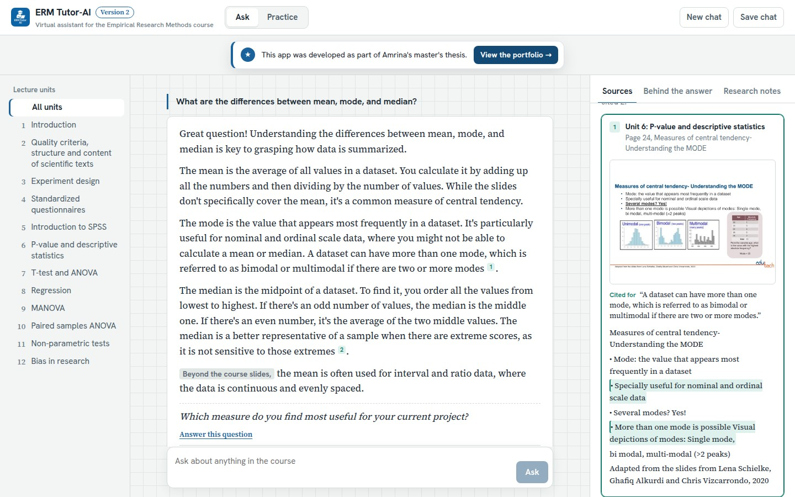
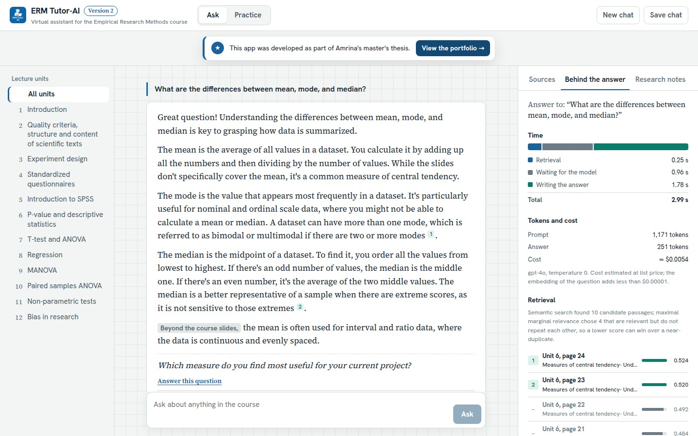
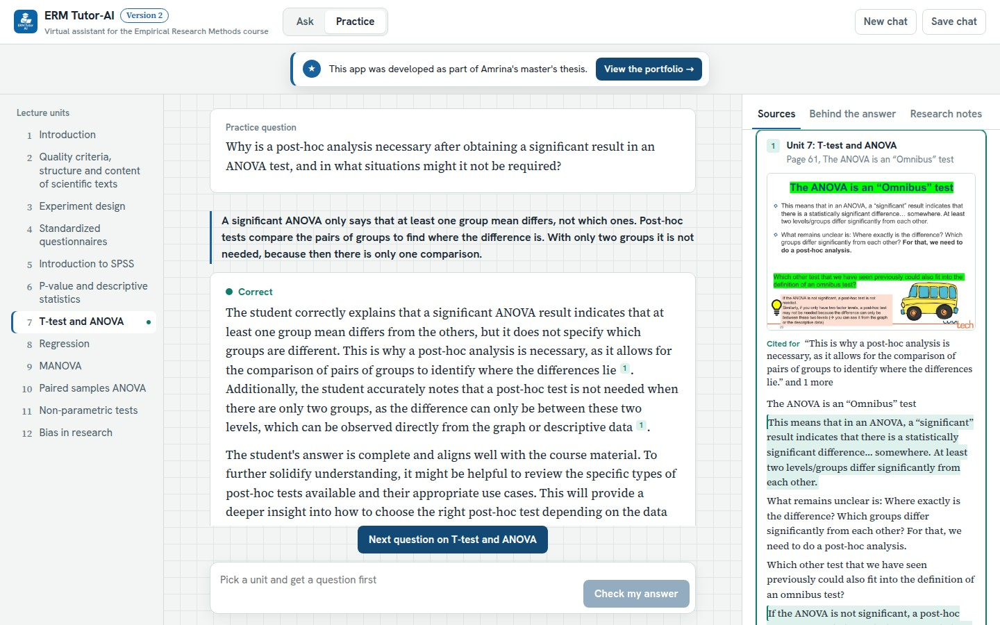
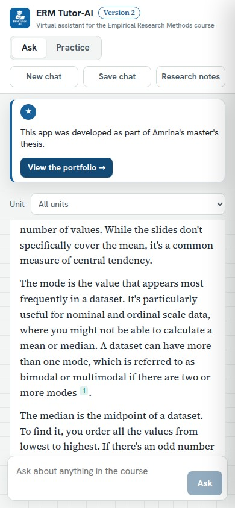
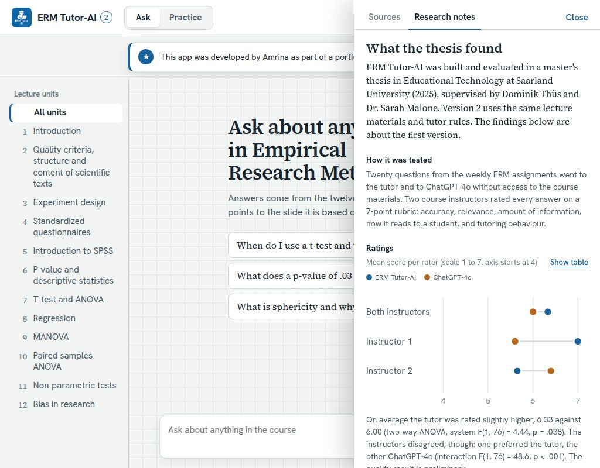

<p align="center"></p>

# ERM Tutor-AI 2: an AI tutor that cites the lecture page for every statement

[](https://github.com/sayamrina/erm-tutorai-2/actions/workflows/ci.yml)

**Version 2 of my master's thesis project · M.Sc. Educational Technology · Saarland University**
Amrina · Supervisors: Dominik Thüs and Dr. Sarah Malone

🌐 **Project page:** https://sayamrina.github.io/erm-tutorai-2/ · 🚀 **Live app:** https://sayamrina.github.io/erm-tutorai-2/open.html (wakes the free server, then opens https://erm-tutorai-2.onrender.com/) · 👤 **Portfolio:** https://sayamrina.github.io

↩️ **Version 1 (thesis app):** [project page](https://sayamrina.github.io/ERM_TutorAI_v4/) · [live app](https://erm-tutorai.streamlit.app/) · [code](https://github.com/sayamrina/ERM_TutorAI_v4) · 📄 [Thesis](https://doi.org/10.5281/zenodo.23749487)

ERM Tutor-AI is a virtual assistant for students in the *Empirical Research Methods* (ERM) course. Like version 1, it answers from the course's twelve lecture units with **Retrieval-Augmented Generation (RAG)**, behaves like a tutor rather than a search engine, and declines questions outside the course.

Version 2 keeps the same lecture materials and model, tightens the tutor rules (the slides first, a citation for every sentence, general knowledge only for gaps and marked as such) and makes the answers easier to check and to learn from: every statement points to the lecture slide it is based on, shown as the slide itself with the supporting lines marked; a practice mode gives feedback on the student's own answers; a "Behind the answer" panel shows what retrieval found, how long each step took and what the answer cost; and an evaluation script measures the tutor on the 20 thesis questions.



---

## Why a version 2

The thesis showed that grounding a tutor in the course materials gives shorter, focused answers. Two things it listed as next steps shaped this version:

- **Citations at passage level.** Version 1 named one source file under each answer. A student who wants to check a claim still has to search the PDF. Version 2 links each statement to the exact lecture page.
- **Adaptive feedback.** Version 1 only answered questions. Version 2 adds a practice mode in which the student answers and the tutor gives feedback, a first step towards the adaptive feedback proposed in the thesis.

## What is new in version 2

| | Version 1 (thesis) | Version 2 |
|---|---|---|
| Sources | Name of one source file under the answer | Numbered citations after each statement, with a preview on hover; each opens the lecture slide as an image (zoomable), its text, and the lines that share the most words with the cited statement |
| Where an answer comes from | Label "course materials" or "general knowledge" | The same two labels, now derived from whether the answer cites a passage, plus a strip of twelve ticks showing which lecture units the answer used |
| Tutor rules | Course materials first, general ERM knowledge second | The slides are the source; a citation for every sentence; general knowledge only for gaps, introduced with "Beyond the course slides" and marked in the interface |
| Course focus | All units | All units, or one chosen unit |
| Practice | – | The tutor writes a question from a lecture slide, the student answers, the feedback gives a verdict (correct, partly correct, not yet) and cites the slides to review |
| Follow-up | Written in the answer | Shown separately with a button to answer it; the last two turns are sent along so the tutor can follow the conversation |
| Behind the answer | – | The 10 candidate passages with their similarity scores and which 4 maximal marginal relevance chose, time for retrieval, waiting and writing, tokens and estimated cost |
| Practice progress | – | Verdicts per lecture unit, kept in the browser, as a map of the twelve units |
| Research notes | PDF "About this app" | Side panel with the evaluation design, ratings chart (or table), answer length, limits and the automatic check of version 2 |
| Other | – | Streaming answers; the conversation survives a reload (New chat clears it); save as Markdown; copy an answer with its sources; helpful / not helpful buttons; a start page that wakes the sleeping free server; light and dark mode; mobile layout |

| Behind the answer | Practice mode |
|---|---|
|  |  |

<p></p>

## How it works

1. **Indexing** (`backend/app/ingest.py`). The 12 lecture PDFs (unchanged from version 1) are read page by page with pdfminer, the engine Markitdown uses for PDFs, and split into chunks of up to 1,500 characters with 50 characters overlap, as in version 1. Each chunk keeps its unit, page and slide title (`backend/data/chunks.json`, 354 chunks).
2. **Embeddings.** OpenAI `text-embedding-3-small`, as in the live version 1 app. They are computed once at start-up and cached in `backend/data/embeddings.npy`.
3. **Retrieval** (`retrieval.py`). Cosine similarity with maximal marginal relevance, 4 passages from 10 candidates, as in version 1; optionally limited to one unit.
4. **Answering** (`tutor.py`). GPT-4o, temperature 0. The prompt keeps the version 1 tutor style (reflection, answer and follow-up woven into one reply) and its refusal sentence, but revises the source rules: the numbered course passages are the source, every sentence that uses one ends with its number, and general ERM knowledge is allowed only for what the passages do not cover, introduced with "Beyond the course slides," so the interface can mark it. Answers stream to the browser as server-sent events. Version 1 keeps the original prompt.
5. **Trace.** With each answer the backend sends what happened behind it: the candidates and scores from retrieval, timings, and the token usage reported by the API, priced at list price (`config.py`).
6. **Slides** (`slides.py`). At build time every lecture page is rendered to a WebP image with pypdfium2 (395 slides, about 13 MB), so the source panel can show the slide as the student knows it.
7. **Interface.** React and TypeScript, served by the FastAPI backend. Which lines of a passage support a statement is computed in the browser by word overlap, without a model call.

Without an OpenAI key the app runs in **demo mode**: keyword search (BM25) over the same chunks shows the matching passages, but there are no tutor answers and no practice questions. The public deployment limits model calls per browser session per hour and per day.

| Layer | Version 1 | Version 2 |
|---|---|---|
| Interface | Streamlit | React 18, TypeScript, Vite |
| API | – | FastAPI, server-sent events |
| LLM | OpenAI GPT-4o | OpenAI GPT-4o |
| Orchestration | LangChain (RetrievalQA) | Direct API calls |
| Vector store | ChromaDB | NumPy (cosine, MMR); rank-bm25 for demo mode |
| PDF parsing | Markitdown | pdfminer.six, page by page |
| PDF to images | – | pypdfium2, at build time |
| Tests and delivery | Streamlit Cloud | pytest (16 tests), an evaluation script, GitHub Actions, Docker, Render |

Version 2 calls the OpenAI API directly, because streaming and numbered citations need control over the prompt and the passages, and 354 vectors fit comfortably in memory.

## Automatic check of version 2

`backend/eval/run_eval.py` asks a running app the 20 evaluation questions of the thesis, each in a fresh conversation, plus three off-topic questions, and measures what can be checked without a human rater. Both runs on 3 November 2026 against the live app, first with the tutor rules of version 1, then with the revised rules of version 2 ([report v1 rules](backend/eval/results/2026-11-03-v1-prompt.md), [report v2 rules](backend/eval/results/2026-11-03-v2-prompt.md)):

| Check | Version 1 rules | Version 2 rules |
|---|---|---|
| Answers based on the course materials | 20 of 20 | 20 of 20 |
| …that add general knowledge, marked "Beyond the course slides" | – | 19 of 20 |
| Off-topic questions declined | 3 of 3 | 3 of 3 |
| A passage from the unit the thesis assigned to the question cited | 18 of 20 | 18 of 20 |
| Statements with a citation | 24% | **41%** |
| Statements neither cited nor marked as general knowledge | 76% | **45%** |
| Cited statements sharing at least two content words with the cited slide | 96% | 99% |
| Answer length | 190 ± 53 words | 192 ± 48 words |
| Median time to the full answer | 3.0 s | 2.8 s |
| Cost of the whole run | about $0.10 | about $0.12 |

What this shows: with the version 1 rules the tutor stayed in the course but cited only about one statement in four, because it mixed slides with general knowledge and often cited once per paragraph. The version 2 rules make the slides the source, ask for a citation per sentence and require general knowledge to be marked; citations rose to 41% and unmarked statements fell from 76% to 45%. Many of the remaining unmarked sentences restate the passage cited in the next sentence or add small steps from general knowledge without the marker, so prompt rules alone do not get every sentence cited. Word overlap is a cheap proxy for support, not a judgement of correctness; the two "misses" (Q3, Q4) cited a neighbouring unit that also covers hypotheses and factors.

```bash
cd backend && ../.venv/bin/python -m eval.run_eval --url https://erm-tutorai-2.onrender.com
```

## Evaluation of version 1 (thesis)

The thesis evaluated version 1:

- **Questions:** 20 representative questions from the weekly ERM assignments, covering all course units.
- **Systems:** ERM Tutor-AI vs. ChatGPT-4o (without retrieval) as the baseline.
- **Raters:** two course instructors, using a 7-point rubric adapted from Lee (2024): accuracy, relevance, excessive or insufficient information, user perception, and tutoring behaviour.

Mean rubric score (± SD), re-computed from the raw ratings:

| Rater | ERM Tutor-AI | ChatGPT-4o |
|---|---|---|
| Both instructors (n = 40) | 6.33 ± 1.00 | 6.00 ± 0.75 |
| Instructor 1 (n = 20) | 7.00 ± 0.00 | 5.60 ± 0.50 |
| Instructor 2 (n = 20) | 5.65 ± 1.04 | 6.40 ± 0.75 |

On average the tutor was rated slightly higher (two-way ANOVA, system F(1, 76) = 4.44, p = .038), but the two instructors disagreed on which system was better (interaction F(1, 76) = 48.6, p < .001), so the quality result is preliminary. The tutor's answers were shorter (198 vs. 280 words on average) and more consistent in length.

These figures were re-checked against the raw ratings after the thesis was submitted and replace the summary table in the thesis (6.75 vs. 6.00).



## Limitations

- The evaluation used 20 questions and two raters who were not blind to the system and who disagreed.
- There was no study with students, so effects on learning and engagement are unknown.
- The knowledge base is limited to the course materials, and the system was not compared with other architectures.
- Version 2 has only been checked automatically. About 45% of its statements are still neither cited nor marked, and word overlap cannot tell whether a cited slide really supports a statement, so the source panel is there for students to check.

## Next steps

A study with students that compares version 1 and version 2 (do page-level citations change how often students check an answer, and how much they trust it?), a human rating of whether cited slides support the statements, and practice questions that adapt to what each student already answered correctly.

## Run it locally

```bash
git clone https://github.com/sayamrina/erm-tutorai-2.git
cd erm-tutorai-2

# backend (Python 3.12)
python -m venv .venv && .venv/bin/pip install -r backend/requirements-dev.txt
cd backend && ../.venv/bin/pytest -q                        # 13 tests
echo "OPENAI_API_KEY=sk-..." > .env                         # leave out for demo mode
../.venv/bin/uvicorn app.main:app --port 8096

# frontend (Node 22), in a second terminal
cd frontend && npm ci && npm run dev                        # http://127.0.0.1:5173
```

`npm run build` writes the frontend to `backend/static`, which the backend then serves on its own port. To rebuild the chunks from the PDFs: `cd backend && ../.venv/bin/python -m app.ingest`. To render the slide images: `../.venv/bin/python -m app.slides` (the Docker build does this itself).

**Deploy on Render:** New → Blueprint → this repository (`render.yaml`), then add `OPENAI_API_KEY` in the dashboard.

## Repository structure

```text
backend/
  app/
    main.py        FastAPI app: ask, practice, rating and health endpoints, rate limits, static files
    ingest.py      PDF parsing per page and chunking with unit, page and slide title
    retrieval.py   embeddings, cosine similarity + MMR, BM25 for demo mode, retrieval trace
    tutor.py       tutor prompt, numbered passages, practice questions and feedback, timings and tokens
    slides.py      renders the lecture pages to images (build time)
    config.py      settings from environment variables
  data/
    materials/     ERM lecture PDFs used as the knowledge base (same as version 1)
    chunks.json    354 chunks with their metadata
  tests/           pytest
  eval/            questions.json, run_eval.py, results/ (the automatic check)
frontend/src/      React interface (chat, source panel, Behind the answer, practice mode, research notes)
docs/              project page and the start page that wakes the server (GitHub Pages)
Dockerfile, render.yaml
```

## Author

**Amrina** · [LinkedIn](https://www.linkedin.com/in/amrina-ali-487025119/) · [GitHub](https://github.com/sayamrina)

Master's thesis in Educational Technology, Saarland University, 2025. Lecture materials: Empirical Research Methods course, Saarland University.

This app was built by Amrina, with AI as a supporting tool for coding.

© 2025–2026 Amrina. All rights reserved.
